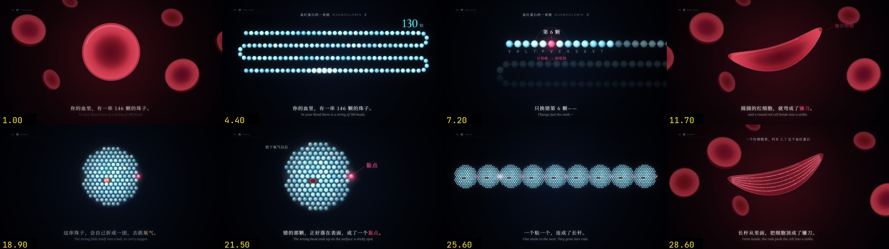

# Concept Reel · Vibe知识大赏短片工具

面向「Vibe知识大赏」（vibe知识大赏）的知识短片创作，把一个主题变成可预览、可修改、可重复渲染的字幕动画。由 [Jogzh](https://github.com/Jogzh) 维护，来源与许可见 [NOTICE.md](NOTICE.md)。

Concept Reel 使用 JavaScript Canvas 描绘画面，Playwright 按时间捕获每一帧，FFmpeg 编码视频，Python 合成事件音效。适用于无旁白的知识解释、机制演示和图文叙事，当前画幅为 **1920×1080 横屏**。



## 这个版本做了什么

- 参考 [mg-styles-15](https://github.com/Vincentwei1021/mg-styles-15)，新增 15 种动态设计风格、机器可读配方、AI 选型方法与可运行风格画廊。
- 风格独立于旧 B/C 外观，支持 `--style`、`--list-styles`、`--describe-style`；旧工程保持兼容。
- 统一项目与 skill 名称为 `concept-reel`，重写安装、创作与贡献说明。
- 默认使用 Playwright 自带 Chromium，可选择本机 Chrome。
- 补全示例入口，检查参数、字体和环境；页面错误与编码失败返回明确错误。
- 改进并行渲染、临时文件处理和确定性检查，避免失败后误报成功。
- 新建工程可设置标题、时长和帧率，自动生成分镜模板；音频命令支持显式 BGM 音量。
- 参考 `ai-video` 的内容驱动制作约定，补自动化测试与 CI。

## 安装

需要 Python **3.10+** 和 FFmpeg（包含 `ffprobe`）。Node.js 用于贡献时的 JavaScript 语法检查，视频运行本身不依赖 Node。

```bash
git clone https://github.com/Jogzh/concept-reel.git
cd concept-reel
python3 -m venv .venv
source .venv/bin/activate
python -m pip install -r requirements.txt
python -m playwright install chromium
python engine/get_fonts.py
python scripts/check_env.py
```

Windows 使用 `.venv\Scripts\Activate.ps1` 激活环境。macOS 可用 `brew install ffmpeg`；Linux 可用发行版包管理器安装 FFmpeg。Linux 的浏览器系统依赖可通过 `python -m playwright install --with-deps chromium` 安装。

字体来自 Google Fonts，使用 SIL OFL 许可。下载脚本只补缺失或无效文件，`--check` 只检查、不下载。完整中文字体文件较大，未随仓库分发；网络受限时，按脚本提示手动下载。运行期间不需要连接云端模型或视频服务。

## 先预览一个示例

```bash
python engine/render.py examples/fold_C --serve
```

打开命令打印的地址，默认是 `http://127.0.0.1:8765/?play`。用 `?t=12.5` 检查某一时刻；修改 `film.js` 后刷新页面。浏览器入口通过内置服务器加载共享引擎，直接双击 HTML 无法可靠加载字体。

```bash
python engine/render.py examples/fold_C --sheet 16
python engine/render.py examples/fold_C --clip 0 3 preview
```

拼图位于 `review/sheet.jpg`，片段位于 `renders/preview.mp4`。更多工程见 [examples/README.md](examples/README.md)。仓库包含源码与代表性预览图，完整 MP4 需要本地渲染。

## 用 Agent 制作

让支持本地 skill 的 Agent 读取本仓库的 `SKILL.md`，例如：

> 使用 concept-reel 做一条 Vibe知识大赏视频，解释“为什么同样的概率会带来不同的直觉”。制作 60 秒横屏字幕短片，先整理事实和分镜，再做一个关键镜头供预览，最后导出 MP4。

skill 包含选题、事实表、分镜、代码、视觉检查和音频流程。仅需预览时可以停在预览与源码交付；请求成片时才导出完整视频。

也可以让 Agent 自主探索：“先比较 2–3 种适合这个主题的风格，选一个主风格，可加一种辅风格；说明画面怎样帮助理解，再制作关键镜头。”构图、动作配方与实现范围见 [15 种风格与选型](references/styles.md)。

如果使用支持 `~/.codex/skills/` 的 Agent，可在该目录链接此仓库，并使用 `concept-reel` 作为目录名。也可以直接指定 `SKILL.md` 的绝对路径，无需安装。

## 自己写画面

```bash
python scripts/new_film.py --list-styles
python scripts/new_film.py --describe-style isometric
python scripts/new_film.py projects/probability --style isometric \
  --title "概率与直觉" --duration 60 --fps 30
```

命令生成 `index.html`、`film.js` 和 `storyboard.md`，保留已有分镜。风格配方写进源码，方便 AI 调整色板、节奏与主体；骨架能运行，主题画面需按分镜编写。

| 风格 ID | 视觉语言 | 风格 ID | 视觉语言 | 风格 ID | 视觉语言 |
| --- | --- | --- | --- | --- | --- |
| `cel-boil` | 逐帧手绘 | `isometric` | 等距 2.5D | `flat-vector` | 扁平矢量 |
| `line-art` | 极简线稿 | `3d-render` | 柔塑立体适配 | `morph` | 形状变形 |
| `sticker` | 贴纸科普 | `hud` | 信息仪表 | `collage` | 拼贴剪纸 |
| `aurora-glass` | 极光玻璃 | `bauhaus` | 包豪斯几何 | `synthwave` | 霓虹复古 |
| `pixel` | 像素叙事 | `liquid` | 液态流动 | `variety` | 综艺花字 |

`--list-styles --json` 输出完整参数，`--describe-style ID --json` 输出单种配方。背景、字幕与主体分别绘制，支持混合与自定义。3D、玻璃、液态提供 Canvas 视觉适配；真实网格光照、折射、流体求解需要额外实现。当前全部为横屏。

```bash
python engine/render.py examples/style_gallery --serve
python engine/render.py examples/style_gallery --sheet 2 6 10 14 18 22 26 30 34 38 42 46 50 54 58
python engine/render.py examples/style_gallery --det
```

画廊是原创几何练习，不是新片的固定模板。仍可使用两种兼容起始外观；`--world` 与 `--style` 互斥，不指定时默认 C：

| 选项 | 外观 | 常见用途 |
| --- | --- | --- |
| `--world C` | 夜曲：暗底、冷光、衬线字 | 抽象概念、微观机制、小实验 |
| `--world B` | 寓言：色块场景、角色、仪表 | 行为机制、生活情境、对照 |

共享字体、配色与动作语言；主体位置、标签与阅读停留按镜头内容安排。制作方法见 [docs/production-guide.md](docs/production-guide.md)，API 见 [references/engine.md](references/engine.md)。

```bash
# 编辑分镜和 film.js，然后预览、检查关键帧
python engine/render.py projects/probability --serve
python engine/render.py projects/probability --stills 2.5 8 15
python engine/render.py projects/probability --motion 8 10 12
python engine/render.py projects/probability --det

# 全片、事件表、音效与最终合成
python engine/render.py projects/probability --jobs 4
python engine/render.py projects/probability --events
python engine/audio.py projects/probability
```

输出：`renders/raw.mp4`（无声）→ `audio/events.json` → `audio/score.wav` → `renders/final.mp4`。

加入你有权使用的配乐：

```bash
python engine/audio.py projects/probability --bgm music.mp3 --bgm-db -8
# 只合成事件音轨，不需要视频文件或 FFmpeg
python engine/audio.py projects/probability --wav-only
```

`--wav-only` 不混入外部 BGM；外部配乐在最终 MP4 合成时叠加。兼容旧写法 `--bgm music.mp3 -8`。

## 常用命令

| 命令 | 用途 |
| --- | --- |
| `python scripts/check_env.py --json` | 机器可读环境诊断 |
| `python scripts/new_film.py --list-styles --json` | 15 种风格的机器可读参数与创作配方 |
| `python scripts/new_film.py --describe-style pixel` | 单种风格的特征、用途与实现范围 |
| `python engine/get_fonts.py --check` | 检查字体与 OFL 文件 |
| `python engine/render.py PROJECT --sheet 16` | 均匀取帧检查整体构图 |
| `python engine/render.py PROJECT --sheet 2 8 15` | 检查指定时刻 |
| `python engine/render.py PROJECT --clip 0 5 head` | 渲染局部片段 |
| `python engine/render.py PROJECT --serve --port 9000` | 自定义预览端口 |
| `python engine/render.py PROJECT --browser chrome --det` | 使用本机 Chrome 检查确定性 |
| `python engine/audio.py --help` | 音频参数 |
| `python -m unittest discover -s tests -v` | 自动化测试 |

一次渲染操作选择一种模式，`--jobs` 用于全片渲染。取帧与片段时间须在 `[0, END]` 内，片段至少包含一帧。命令报错时先检查 `--help` 与环境诊断；不要把失败留下的文件当作有效成片。渲染耗时随时长、复杂度、机器与并行度变化，建议先拼图，再短片段，最后全片。

## 目录

```text
concept-reel/
├── SKILL.md                 # Agent 创作入口
├── README.md                # 安装与使用
├── NOTICE.md / LICENSE      # 来源、资源与许可
├── engine/                  # Canvas、15 种风格配置与组件、渲染、音频和字体管理
├── scripts/                 # 创建工程、环境诊断、集成检查
├── docs/production-guide.md # 内容驱动制作与验收
├── references/              # 分镜、视觉方法与引擎 API
├── examples/                # 上游示例、风格画廊与 smoke 示例
├── tests/                   # 参数、失败路径和文件处理测试
└── projects/                # 你的工程；产物默认忽略
```

## 来源与许可

感谢原 skill 作者 [Dave-cc](https://github.com/Dave-cc)。项目保留 MIT 许可，资源与材料说明见 [NOTICE.md](NOTICE.md)。

制作规范参考 Jogzh 的 `ai-video` 本地项目（`docs/video-style-guide.md` 和环境检查思路），在本仓库改写为 Canvas 工作流；不依赖该目录，也不引入其私人素材。技术依赖为 [Playwright](https://playwright.dev/python/)、[FFmpeg](https://ffmpeg.org/)、[NumPy](https://numpy.org/)、[SciPy](https://scipy.org/)、[Pillow](https://python-pillow.github.io/)；字体来自 [Google Fonts](https://github.com/google/fonts)。

代码与自行编写的文档适用 [MIT](LICENSE)，字体适用各自 OFL 许可。上游明确排除许可的第三方复刻材料已从本版本移除；保留的示例均标明来源，主题事实、引用、音乐和额外素材仍需按各自权利与出处使用。详细说明见 [NOTICE.md](NOTICE.md)。

贡献流程见 [CONTRIBUTING.md](CONTRIBUTING.md)。
